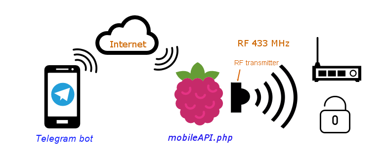

# mobileAPI.php

A small PHP HTTP API for triggering 433 MHz RF actions on a Linux host. It was originally used with a Raspberry Pi and can now be called by a Telegram bot or another HTTP client. The bot itself is not included in this repository; it sends HTTP POST requests to this API.

## Architecture

## Requirements

- Linux host with PHP 8 and a web server such as Nginx or Apache.
- A 433 MHz RF transmitter connected to the host, plus a compatible receiver.
- `codesend` from 433Utils installed and executable by the web server account.
- HTTPS when the API is reachable over a network.

A Raspberry Pi is a convenient host when using GPIO-connected RF hardware. Other Linux hosts can be used with compatible transmitter hardware and a suitable `codesend` binary.

## Setup

1. Configure the RF code, `codesend` path, user credentials, and allowed actions near the top of `mobileAPI.php`.
2. Place `mobileAPI.php` in a directory served by your web server.
3. Grant the web server account the permissions it needs to access the RF transmitter and run `codesend`. This version does not use `sudo`.
4. Configure your Telegram bot or other client to send HTTPS POST requests to the API endpoint.

## HTTP API

Send `application/x-www-form-urlencoded` POST fields:

| Field | Description |
| --- | --- |
| `uid` | User name configured in `$users` |
| `pwd` | Password configured for that user |
| `action` | An action allowed for that user |

Actions included in this example:

- `ping` — check that the credentials and action are accepted.
- `open` — send the configured `$rfCode` using `codesend`.
- `your_action` — example custom action that sends a second RF code; rename or replace it for your use.

Responses are plain text: `1` means the request was accepted; `2` means the user is unknown or the password is incorrect; `3` means the action is not allowed; `4` means a required field is missing or invalid. The RF command runs in the background, so response `1` does not confirm that the receiver got the signal.

## Security

- Use HTTPS so credentials are not sent in clear text.
- Restrict access to the endpoint where possible, and use unique credentials with only the actions each user needs.
- Do not commit real passwords to a public repository. Keep deployment credentials in a private configuration file or inject them from the server environment.

## RF reliability

If RF reception is unreliable, improving antenna placement or repeating a transmission may help. Only repeat an action when the receiver can safely handle duplicate signals; a duplicate may toggle a switch or lock twice.
